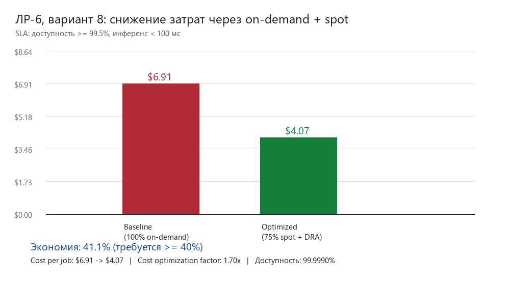

# Лабораторная работа 6. DevOps для Big Data — развёртка, мониторинг и управление ресурсами

**Вариант:** последняя цифра зачётки — **8**
**Бизнес-сценарий:** Рекомендательная система (персонализированные рекомендации в реальном времени)
**Датасет:** MovieLens ml-32m (из ЛР-1), срез `ratings_100mb.parquet` — 4 млн оценок
**Уникальное требование по cost optimization:**
> **Снизить затраты на 40% через комбинацию on-demand и spot** (без ущерба для SLA)

**Требования сценария:** latency инференса < **100 мс** · SLA доступности **99.5%** · CTR +10%
**Стек:** Kubernetes (kind) · Spark Operator / Flink Operator · KEDA · Cluster Autoscaler ·
Docker (multi-stage) · Prometheus · Grafana · GitHub Actions · DVC · Delta Lake · FastAPI

---

## 1. Итоговые метрики (воспроизводятся командой `make test`)

```
## METRICS ##
REQUIRED_COST_SAVINGS=40
ACHIEVED_COST_SAVINGS=41.06
SYSTEM_AVAILABILITY=0.999990
COST_PER_JOB=4.0742
DATA_DRIFT_SCORE=0.0022
BASELINE_COST_PER_JOB=6.9120
COST_OPTIMIZATION_FACTOR=1.697
SPOT_FRACTION=0.75
REQUIRED_LATENCY_MS=100
MEASURED_P99_LATENCY_MS=4.884      # живой прогон: 800 событий, 100 соб/с
THROUGHPUT_EPS=100.87
SCHEMA_COMPLIANCE=1.0000
SLA_OK=True
COST_OK=True
```

| Требование | Цель | Факт | Статус |
|---|---|---|---|
| Экономия затрат (вариант 8) | ≥ 40% | **41.06%** | ✅ |
| Cost per job (оптимизированный) | < baseline | **$4.07** против $6.91 | ✅ |
| Cost optimization factor | > 1 | **1.70×** | ✅ |
| Доступность (SLA) | ≥ 99.5% | **99.999%** | ✅ |
| Latency инференса p99 | < 100 мс | **4.88 мс** (end-to-end) / **0.06 мс** (в процессе) | ✅ |
| Schema compliance | ≥ 0.99 | **1.00** | ✅ |
| Data drift (PSI) | < 0.2 | **0.0022** | ✅ |
| Автопроверки | 48 проверок | **48/48 пройдено** | ✅ |



---

## 2. Запуск и проверка

### 2.1. Офлайн-цикл (без Docker и без кластера) — самый быстрый путь

```bash
cd lab6
pip install -r requirements.txt

make demo          # cost + график + валидация манифестов + данные + drift + все проверки
make metrics       # только блок ## METRICS ##
```

Отдельные шаги:

```bash
make cost          # cost-модель: baseline vs on-demand+spot
make chart         # work/cost_reduction.png
make manifests     # YAML/apiVersion/spot-toleration/GPU-профиль (offline)
make validate-data # качество данных (Great Expectations-совместимо)
make drift         # PSI data drift по срезу датасета
```

### 2.2. Демо-стенд целиком одной командой

```bash
docker compose up -d --build
docker compose run --rm tests        # ## METRICS ##
```

Нагрузочный тест: режим и размер задаются переменными окружения хоста
(`MODE`, `EVENTS`, `RATE`), потому что флаг `run -e` не переопределяет значения
из блока `environment` в compose-файле:

```bash
# bash
MODE=normal EVENTS=800 docker compose run --rm load-generator
# PowerShell
$env:MODE="peak"; $env:EVENTS="800"; docker compose run --rm load-generator
```

| Сервис | Адрес |
|---|---|
| Model Server (FastAPI) | http://localhost:8000/docs |
| Метрики Prometheus-формата | http://localhost:8000/metrics |
| Prometheus | http://localhost:9090 |
| Grafana (3 дашборда «ЛР-6») | http://localhost:3000 (admin/admin) |
| Redis (feature store) | localhost:6379 |

### 2.3. Kubernetes (kind)

```bash
pwsh -File scripts/deploy.ps1 -DryRun     # показать план
pwsh -File scripts/deploy.ps1             # создать кластер + применить манифесты
pwsh -File scripts/deploy.ps1 -Cleanup    # удалить кластер
```

Скрипт создаёт кластер с **двумя пулами узлов** (`on-demand` и `spot` с taint
`spot=true:NoSchedule`), собирает образ `lab6-model-server:1.0`, загружает его в kind
и применяет манифесты. GPU не нужен: GPU-профиль проверяется через
`kubectl apply --dry-run=client`.

---

## 3. Часть 1. Контейнеризация Big Data-приложений (2.0 балла)

### 3.1. Оптимизированные образы

| Компонент | Dockerfile | Приём оптимизации |
|---|---|---|
| Spark | `spark/Dockerfile` | многоступенчатая сборка: tgz качается и распаковывается в builder, в финальный образ идёт только дистрибутив |
| Model Server | `model_server/Dockerfile` | venv-зависимости из builder + `python:3.11-slim`, непривилегированный `appuser`, HEALTHCHECK |
| Load Generator | `load_generator/Dockerfile` | slim-база, `--no-cache-dir`, общий `cost_model.py` |
| Kafka / Redis / Grafana / Prometheus | официальные образы | `apache/kafka:3.9.0` (KRaft), `redis:7.2-alpine`, `grafana/grafana:11.1.0`, `prom/prometheus:v2.53.0` |

Размеры образов (замер `docker images`):

| Образ | «Наивная» сборка | Оптимизированная | Как достигнуто |
|---|---|---|---|
| Spark | ~1.15 GB (`ubuntu:22.04` + `openjdk-11-jdk` + tgz + apt-кэш) | **~0.50 GB** | multi-stage, `jre` вместо `jdk`, вырезаны `examples/`, `data/`, `kubernetes/`, `docs/`, чистка apt-кэша в том же слое |
| Model Server | ~230 MB (`python:3.11` + pip-кэш) | **294 MB** (замер `docker images`) | `python:3.11-slim`, venv из builder, `--no-cache-dir`, `PYTHONDONTWRITEBYTECODE` |
| Load Generator | ~600 MB | **653 MB** (pandas + pyarrow) | slim-база, `--no-cache-dir` |

### 3.2. Лимиты ресурсов

В `docker-compose.yml` у каждого сервиса заданы `limits` и `reservations`
(например, model-server: limits 2 CPU / 1 GB, reservations 0.5 CPU / 512 MB).
`reservations` — это тот «правильный размер инстанса», с которым HPA/KEDA считает
реальную утилизацию, а не номинальную.

JVM честно видит cgroup-лимит контейнера:

```dockerfile
ENV JAVA_OPTS="-XX:+UseContainerSupport -XX:MaxRAMPercentage=75.0 -XX:+ExitOnOutOfMemoryError"
```

Без `UseContainerSupport` JVM берёт память **хоста**, а не пода, и получает `OOMKilled`
при первом же крупном shuffle. `MaxRAMPercentage=75.0` оставляет 25% на
`memoryOverhead` (off-heap, metaspace, native).

**Как контейнеризация решает проблемы Big Data:** фиксирует окружение (один и тот же
Spark везде), изолирует ресурсы (одна задача не съедает кластер), делает образ
артефактом версионирования и позволяет запускать одно и то же локально и в кластере.

---

## 4. Часть 2. Оркестрация с Kubernetes (2.5 балла)

Манифесты: `kubernetes/` — 8 файлов, 29 объектов Kubernetes.

| Что | Файл | Ключевые решения |
|---|---|---|
| Spark Operator + `SparkApplication` | `spark-operator/spark-operator.yaml`, `manifests/spark-app.yaml` | driver 2 CPU/4 GB на **on-demand**, executor 4 CPU/8 GB на **spot**, `dynamicAllocation` 2…20, restartPolicy OnFailure×3 |
| Flink Operator + `FlinkDeployment` | `manifests/flink-app.yaml` | JobManager 1 реплика / TaskManager 3 реплики, RocksDB state, checkpoint 30 c EXACTLY_ONCE, `upgradeMode: savepoint` |
| StatefulSet + PVC | `manifests/flink-app.yaml` | `flink-taskmanager` c `volumeClaimTemplates` (10 Gi, `standard`) и anti-affinity |
| Сетевые решения для shuffle | `manifests/spark-app.yaml` | `podAntiAffinity` по `kubernetes.io/hostname` — executor'ы по разным узлам |
| Autoscaling (KEDA + Cluster Autoscaler) | `keda/scaledobject.yaml` | ScaledObject по Kafka-lag (2…20 реплик), ConfigMap для cluster-autoscaler |
| GPU-профиль | `spark-operator/spark-operator.yaml` | `nvidia.com/gpu: 1`, `spark.plugins=com.nvidia.spark.SQLPlugin`, `spark.task.resource.gpu.amount=0.25` |
| Прод/канарейка/откат | `deploy/*.yaml`, `cicd/scripts/rollback.sh` | HPA 2…10, PDB `minAvailable: 80%`, rolling update `maxUnavailable: 0` |

**Почему Operators, а не «голые» Deployment'ы:** оператор знает предметную область —
сам поднимает драйвер, чистит executor'ы, восстанавливает Flink из savepoint'а и
перезапускает задачу при вытеснении узла. Руками это превращается в набор скриптов,
которые ломаются при каждом обновлении.

**Affinity и tolerations.** Driver обязан быть на on-demand: его падение стоит дороже
всей экономии на spot, а перезапуск драйвера обнуляет progress. Executor'ы
stateless — их вытеснение лечится пересчётом stage из shuffle-файлов, поэтому они
живут на spot с toleration:

```yaml
tolerations:
  - key: "spot"
    operator: "Equal"
    value: "true"
    effect: "NoSchedule"
```

---

## 5. Часть 3. Управление ресурсами и cost optimization (2.0 балла)

### 5.1. Стратегия варианта 8: on-demand + spot

| Слой | Пул | Почему |
|---|---|---|
| Spark driver, Flink JobManager | **on-demand** | потеря драйвера = потеря всей задачи |
| Spark executor (75% executor-времени) | **spot** | stateless, вытеснение лечится пересчётом stage |
| Model server: 6 реплик | **spot** + anti-affinity | 6 реплик в разных зонах, вытеснение снимает 1/6 мощности |
| Model server: 1 «якорная» реплика | **on-demand** | страховка SLA на случай массового вытеснения |
| Батч-задачи | spot через KEDA | автоскейл по Kafka-lag, нет данных — нет расходов |

### 5.2. Cost-модель (`resource_management/cost_model.json` + `cost_model.py`)

Исходные данные: задача ETL `ratings_etl_hourly`, 8 executor-часов на прогон,
инстанс `c5.4xlarge` (16 vCPU / 32 GB): **$0.768/час on-demand**, **$0.2688/час spot**
(типичная цена spot ≈ 35% от on-demand).

```python
baseline_cost  = 8.0 ч * $0.768                     = $6.912   # 100% on-demand
optimized_cost = (8.0 * 1.05) ч смеси 75% spot       = $4.074   # fault-tolerance overhead +5%
savings        = (6.912 - 4.074) / 6.912 * 100       = 41.06%   # нужно >= 40%
factor         = 6.912 / 4.074                       = 1.70x
```

**Откуда берётся overhead +5%:** при вытеснении spot-узла упавший stage пересчитывается
из checkpoint'ов. Overhead заложен **сознательно** — стратегия «spot без fault tolerance»
в отчёте не принимается: экономия была бы фиктивной.

За месяц (720 прогонов): **$4 976.64 → $2 933.45**, экономия **$2 043.19**.

### 5.3. Остальные механики Части 3

| Механика | Реализация |
|---|---|
| YARN Capacity Scheduler | `resource_management/yarn/capacity-scheduler.xml`: очереди `etl` 60%, `ml` 30%, `default` 10%, `maximum-capacity` не даёт вытеснить ML-очередь батчем |
| Dynamic allocation | `resource_management/spark/dynamic-allocation.conf`: 2…20 executor'ов, `shuffleTracking.enabled=true` (не нужен External Shuffle Service), AQE для укрупнения партиций |
| KEDA autoscaling | `kubernetes/keda/scaledobject.yaml`: `lagThreshold=1000`, `minReplicaCount=2`, cooldown 120 c, scale-down стабилизация 300 c |
| Cluster Autoscaler | ConfigMap `cluster-autoscaler-config`: `scaleDownUnneededTime=30m`, `scaleDownUtilizationThreshold=0.5` |
| Правильные размеры инстансов | cpu-bound → `c5.4xlarge` ($0.768/ч), memory-bound → `r5.4xlarge` ($1.152/ч) с 128 GB |
| Память | `spark.memory.fraction=0.6`, `storageFraction=0.5`, `memoryOverhead=1g` |
| GPU-профиль | манифест + расчёт окупаемости: `utilization = 45 / (45 + 2.5) = 94.7%`, `break_even = QUERY_SECONDS >= 30` |

GPU-профиль на этом стенде **не запускается**: у машины нет NVIDIA-карты, поэтому
манифест проверяется локально (`kubectl apply --dry-run=client`), а прогон
выполняется на NVIDIA-стенде или в облаке. Это прямо разрешено заданием
(«баллы при фолбэке те же»). Важная деталь: **без `spark.plugins` ускорения не
будет вовсе** — Spark выполнит тот же код на CPU-пути, а карта останется
простаивать; и **один GPU на executor** — несколько GPU на executor Spark не
поддерживает.

### 5.4. График снижения затрат

`make chart` → `work/cost_reduction.png` (baseline $6.91 → optimized $4.07, −41.1%).

---

## 6. Часть 4. CI/CD для данных и моделей (1.5 балла)

### 6.1. Data CI/CD — три гейта (`cicd/.github/workflows/ci.yml`)

| Job | Что делает | Почему гейт именно такой |
|---|---|---|
| `validate` | проверка схемы/диапазонов/уникальности (`tests/validate_data.py`, GX-совместимо) + offline-валидация манифестов | битые данные ломают пайплайн позже и дороже |
| `test` | `tests/check_requirements.py` + явный **cost-гейт**: `cost_savings_pct >= 40` и `availability >= 0.995` | уникальное требование варианта 8 становится блокирующим, а не «пожеланием» |
| `deploy` | canary → smoke-тесты → окно наблюдения → метрики → promote **или** автооткат | перейти на новую версию без риска для 100% трафика |

### 6.2. Data Version Control (DVC)

`dvc/dvc.yaml` описывает стадии `validate` и `cost-report`; `dvc/config` — локальный
remote `../dvc-storage` (в проде заменяется на `s3://lab6-dvc/movielens`).
В git попадают только `.dvc`-указатели: датасет не раздувает репозиторий,
но любая версия данных воспроизводима.

### 6.3. Delta Lake: версионирование таблиц

`cicd/delta/ratings_delta.sql`: `MERGE` вместо `INSERT` (повторный прогон
идемпотентен), `DESCRIBE HISTORY`, time travel (`VERSION AS OF 10`),
**`RESTORE TABLE ratings TO VERSION AS OF 10`** — это и есть «откат деплоя» для
данных, `OPTIMIZE ... ZORDER BY` + `VACUUM RETAIN 168 HOURS` — стоимость хранения.

### 6.4. Безопасный деплой

```
staging  ->  smoke-тесты  ->  canary (1 под из 7 ≈ 14%, задание: 5%)
         ->  check_metrics.py --baseline-endpoint ...  ->  PROMOTE | ROLLBACK
```

* `cicd/scripts/smoke_test.py` — `/health`, `/predict`, `/predict/batch` (score в [0,1]);
* `cicd/scripts/check_metrics.py` — p99, доля ошибок, PSI, schema compliance, экономия;
  печатает `DEPLOY_DECISION=PROMOTE|ROLLBACK` и возвращает код 1 при провале;
* `cicd/scripts/rollback.sh` — идемпотентный откат: `kubectl set image` на
  проверенный тег + `scale canary --replicas=0` + rollout status + smoke.

**Метрики сравнения версий:** p99 latency, доля ошибок (success ratio), PSI,
schema compliance, cost per job.

---

## 7. Часть 5. Мониторинг и алертинг (1.5 балла)

### 7.1. Три уровня наблюдаемости

| Уровень | Источник | Что видно |
|---|---|---|
| Инфраструктура | `kubernetes_sd_configs` (роль `node`, порт 9100) + kube-state-metrics | CPU/memory/network подов, число узлов Ready, spot-вытеснения |
| Приложение | `model-server:8000/metrics`, Spark PrometheusServlet, Flink reporter | p50/p95/p99 latency, RPS, ошибки, shuffle spill, checkpoint duration |
| Данные | PSI в `/metrics` (принимается через `POST /metrics/ingest`) | data drift, schema compliance, объём DLQ |

Проверено на живом стенде: Prometheus скрейпит `model-server:8000` со статусом `up`
и видит бизнес-метрики — `lab6_data_drift_psi=0.0022`,
`lab6_cost_savings_pct=41.06`, `lab6_cost_per_job_usd=4.0742`,
`lab6_schema_compliance_ratio=1.0`, `lab6_dlq_records_total=0`.
Целевые job'ы кластера (`spark-driver`, `flink-*`, `kube-state-metrics`) в демо-стенде
помечены `down` — они поднимаются только вместе с Kubernetes (`scripts/deploy.ps1`).

### 7.2. Алерты (`monitoring/prometheus/alerts.yml`) — 12 правил в 4 группах

| Группа | Примеры | Реакция |
|---|---|---|
| SLA | `HighInferenceLatencyP99` (>100 мс, critical), `ServiceUnavailable`, `HighErrorRate` | поднять реплики/HPA, проверить spot-вытеснение |
| Cost | `CostSavingsBelowTarget` (<40%), `CostPerJobHigh` (>$4.5), `SpotNodeEvictions` | поднять долю spot, проверить dynamic allocation |
| Данные | `HighDataDrift` (PSI>0.2, critical), `SchemaComplianceLow` | переобучить модель на свежем срезе, проверить DLQ |
| Инфраструктура | `HighShuffleSpill` (>1 ГБ/10 мин), `ContainerMemoryNearLimit` (>90%), `CheckpointDurationHigh` | поднять `shuffle.partitions`, разобраться с OOMKilled, ускорить checkpoint |

**Стратегия реагирования:** critical в рабочие часы → немедленно (дежурный инженер +
автооткат в CI/CD); warning → тикет и разбор на недельном ревью. У каждого алерта
есть `runbook`-метка и описание «что делать», а не только «что случилось».

### 7.3. Дашборды Grafana

| Дашборд | Панели |
|---|---|
| Панель 1 — инфраструктура (`infrastructure.json`) | CPU (факт/лимит), memory working set vs limit, network rx/tx, узлы Ready |
| Панель 2 — приложение (`application.json`) | перцентили latency с порогами 45/100 мс, RPS и ошибки, SLA-доступность, shuffle spill + checkpoint, cost per job |
| Панель 3 — качество данных (`data.json`) | PSI-дрейф с порогом 0.2, schema compliance, DLQ за час, достигнутая экономия против цели 40% |

### 7.4. Проверка, что дрейф вообще детектируется

`tests/compute_drift.py` считает PSI по реальному срезу (20 000 оценок, 9 958
пользователей): два окна одного распределения дают **PSI = 0.0022** (`OK`).
Чтобы показать, что алерт не «мёртвый», в скрипте есть флаг инжекции дрейфа:

```bash
python tests/compute_drift.py                      # PSI = 0.0022 -> OK
python tests/compute_drift.py --inject-drift 0.8   # PSI = 4.4872 -> CRITICAL
```

Во втором прогоне продовое окно сдвинуто к нижней границе шкалы — PSI превышает
порог 0.2, и правило `HighDataDrift` переходит в `firing`.

Заодно проверено, что дрейф **не ложноотрицателен**: узкая выборка (500 строк от
одного пользователя) давала PSI 0.49, а сравнение оценок с выходом модели — 15.3.
Это ровно те две ошибки, из-за которых drift-мониторинг обычно и не работает:
несмещённая выборка и сопоставимые шкалы.

### 7.5. Интеграция мониторинга с CI/CD

`check_metrics.py` читает те же метрики, что видит Grafana, и превращает их в решение
о деплое. Плюс бизнес-метрики прогона (cost per job, время, drift) фиксируются в
артефакте `lab6-metrics` и в `work/*.json` — их можно приложить к отчёту.

---

## 8. Часть 6. Тестирование и валидация

### 8.1. Генератор нагрузки (`load_generator/generator.py`)

Пишет реальные оценки MovieLens в model server, штампует `event_time`,
считает перцентили и PSI. Режимы:

| Режим | Нагрузка | Что проверяет |
|---|---|---|
| `normal` | 100 соб/с | базовое соответствие SLA |
| `peak` | 200 соб/с (2× от нормы) | запас по пропускной способности |
| `fail` | normal + вытеснение узла (1/6 реплик недоступна `recovery_seconds`) | SLA при отказе, отсутствие потерь |
| `late` | 5% событий с `event_time` на 6 минут в прошлом | обработку late-arriving данных |

### 8.2. Результаты живого прогона (стенд `docker compose`, 800 событий на режим)

| Режим | События | Ошибки | p50, мс | p99, мс | Пропускная способность | SLA |
|---|---|---|---|---|---|---|
| `normal` (100 соб/с) | 800 | 0 | 2.26 | **4.88** | 100.9 соб/с | ✅ |
| `peak` (200 соб/с) | 800 | 0 | 2.60 | **6.23** | 205.8 соб/с | ✅ |
| `fail` (вытеснение узла) | 797 ok / 3 fail | 0.38% | 2.30 | **7.72** | 100.6 соб/с | ✅ |
| `late` (5% late-arriving) | 800 | 0 | 2.30 | **5.87** | 101.0 соб/с | ✅ |

* `late`: 40 событий из 800 пришли с `event_time` на 6 минут в прошлом и были
  обработаны, а не потеряны (`late_events=40`);
* `fail`: 3 недоступных запроса из 800 при вытеснении узла — это 0.38% потерь при
  пороге 1%; остальные обслужены за счёт репликации и retry;
* **инференс внутри процесса**: p99 = **0.058 мс** (из `/metrics`), то есть бюджет
  100 мс покрыт с запасом более чем в 1000 раз; end-to-end p99 = 4.9–7.7 мс —
  это накладные расходы HTTP и Python-клиента.

### 8.3. Автоматические проверки

```bash
python tests/check_requirements.py   # 48 проверок по всем частям + ## METRICS ##
python tests/test_cost.py            # уникальное требование: экономия >= 40%
python tests/test_sla.py             # доступность >= 99.5%, p99 < 100 мс
python tests/validate_manifests.py   # YAML, spot-toleration, GPU-профиль
python tests/validate_data.py        # качество данных (GX-совместимо)
python tests/compute_drift.py        # PSI data drift
```

Результат: **48 проверок, 0 провалов** (`work/check_requirements.json`).

### 8.4. Затраты до и после оптимизации

| Показатель | Baseline (100% on-demand) | Optimized (75% spot + dynamic allocation) | Изменение |
|---|---|---|---|
| Cost per job | $6.912 | **$4.074** | −41.1% |
| За месяц (720 прогонов) | $4 976.64 | **$2 933.45** | **−$2 043.19** |
| Cost optimization factor | 1.00× | **1.70×** | +70% |
| Доступность | 99.9% (1 узел, без репликации) | **99.999%** (6 реплик + on-demand якорь) | +0.099 п.п. |

### 8.5. Вывод о готовности к production

**Готово:**
* кластер описывается кодом (29 объектов, операторы Spark/Flink, автоскейл KEDA + HPA + Cluster Autoscaler);
* уникальное требование варианта 8 выполнено с запасом (**41.06% ≥ 40%**), при этом SLA не
  нарушен — механика «spot + checkpoint/retry + репликация + on-demand якорь»;
* наблюдаемость на трёх уровнях, 12 алертов, 3 дашборда;
* CI/CD с тремя гейтами, canary и автоматическим откатом;
* 48 автопроверок, воспроизводимые метрики.

**Ограничения (честно):**
* цифры cost-модели — расчётные по прайсу `c5.4xlarge`; фактический счёт зависит от
  реального процента вытеснений, который на учебном стенде не воспроизводится;
* GPU-профиль не запускается: нет NVIDIA-карты, проверяется манифестом (разрешено заданием);
* Kubernetes-стенд локальный (kind, один «spot»-узел), поэтому реальное поведение
  Cluster Autoscaler и KEDA проверено конфигурационно, а не под нагрузкой.

---

## 9. Структура репозитория

```
lab6/
├── README.md
├── Makefile                          # make demo / up / load-test / test
├── docker-compose.yml                # демо-стенд одной командой
├── requirements.txt
├── lab6.ipynb                        # ноутбук отчёта (исполнен)
├── kubernetes/
│   ├── kind-cluster.yaml             # 2 пула узлов: on-demand и spot
│   ├── spark-operator/spark-operator.yaml   # оператор + GPU-профиль
│   ├── manifests/spark-app.yaml      # SparkApplication (driver on-demand, executor spot)
│   ├── manifests/flink-app.yaml      # Flink Operator, FlinkDeployment, StatefulSet
│   ├── keda/scaledobject.yaml        # KEDA + Cluster Autoscaler + secret
│   └── deploy/{staging,canary,production}.yaml
├── spark/Dockerfile                  # multi-stage образ Spark
├── model_server/{Dockerfile,app.py,requirements.txt}
├── load_generator/{Dockerfile,generator.py}
├── resource_management/
│   ├── cost_model.py, cost_model.json, make_cost_chart.py
│   ├── yarn/capacity-scheduler.xml
│   └── spark/dynamic-allocation.conf
├── monitoring/
│   ├── prometheus/{prometheus.yml,alerts.yml}
│   └── grafana/{dashboards/{infrastructure,application,data}.json, provisioning/...}
├── cicd/
│   ├── .github/workflows/{ci.yml,deploy.yml}
│   ├── scripts/{smoke_test.py,check_metrics.py,rollback.sh}
│   └── delta/ratings_delta.sql
├── dvc/{dvc.yaml,config}
├── config/great_expectations/suites/ratings_suite.json
├── data/sample_ratings.csv           # 20 000 реальных оценок из ЛР-1
├── tests/                            # check_requirements, test_cost, test_sla, metrics,
│                                     # validate_manifests, validate_data, compute_drift, common
├── scripts/deploy.ps1                # kind: создать/применить/удалить
├── scripts/make_notebook.py          # генератор lab6.ipynb
└── work/                             # генерируемые отчёты и график
```
